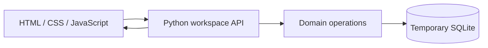

# Freight Connect — engineering quality / engenharia

Owner and maintainer: João Victor da Silva (JustJao1).

EN: Freight search, proposal and trip-cost prototype.
PT: Protótipo de busca de fretes, propostas e custo de viagem.

## Architecture

Browser snapshots are reconstructed per request. This is a bounded portfolio sandbox, not a shared production database.

## Decision record / decisões
ADR-001: Keep demo records fictional and separate estimated trip costs from routing guarantees.
ADR-002: Use loopback-only local access; the Docker port is published to the host loopback and no real credentials are included.

## Run / Executar
Python 3.11: pip install -r requirements.txt; python run.py.
Docker: docker compose up --build --wait; open http://127.0.0.1:8765/. Stop with docker compose down. Base image patch versions and any dependency ranges can change on rebuild; use lockfiles and digests for byte-identical production builds. Do not expose the demo publicly from this container.

## Verification
Run python -m unittest discover -s tests -v. The [CI workflow](https://github.com/JustJao1/freight-connect/actions/workflows/engineering-quality.yml) publishes actual test logs and branch coverage, and checks the container health. Coverage is not a claim of complete end-to-end testing.

## Technical demo (EN)
Filter fictional loads by origin and vehicle, estimate net trip revenue and inspect a sample route.

## Demonstração (PT)
Filtre cargas fictícias por origem e veículo, estime receita líquida e confira uma rota.

## Limitations
Not a live marketplace. OSRM car routes do not account for truck restrictions; external maps require network access.

## AI-assisted review
Inspect diffs, validate input and authorization boundaries, run tests, and inspect CI output before merging. Do not share secrets or customer data. This is a proposed ongoing review procedure, not evidence about every historical change.
